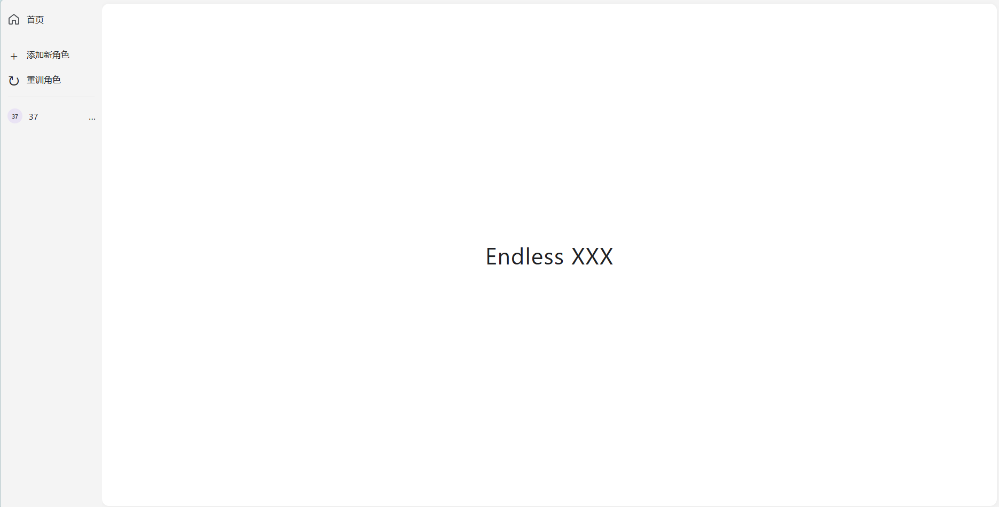
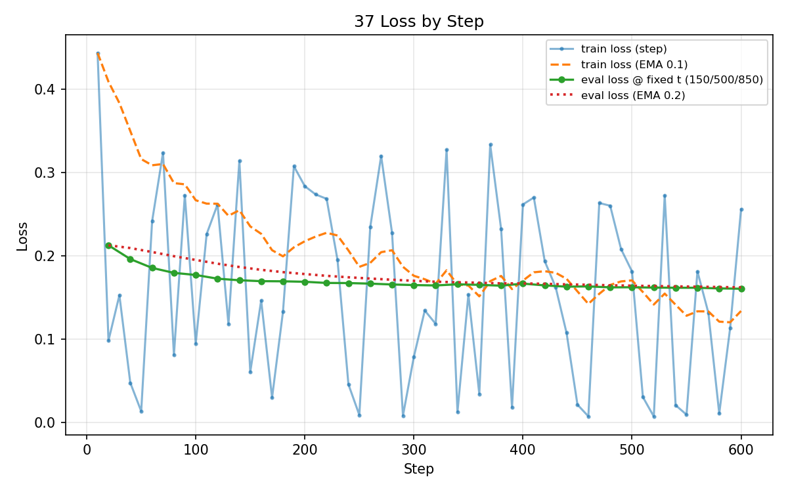

# Endless-XXX

[中文](README.md) · [English](README.en.md)

**Main project and application entry: [Endlexx](https://github.com/ZerothXX/Endlexx).** This repository owns character LoRA training and visual-transfer research across open-domain subjects. Endlexx provides the agent workbench, character knowledge, independent chats, context management and tool orchestration. The training core stays here; linking the homepages does not merge code or synchronize revisions.

[Project home](https://github.com/ZerothXX/Endlexx#readme) · [Research overview](https://github.com/ZerothXX/Endlexx/blob/main/docs/research/overview.en.md) · [Results and limitations](https://github.com/ZerothXX/Endlexx/blob/main/docs/research/results.en.md) · [Application source](https://github.com/ZerothXX/Endlexx)

| Capability | This research repository | Endlexx application |
|---|---|---|
| Character LoRA fine-tuning | Standard and 24GB configuration entries | Training jobs/UI not integrated |
| Character image transfer | Research inference and subject-specific policies | Another local inference snapshot integrated; quality failures remain |
| Knowledge, independent chats and context | Outside the training core | Implemented |
| General text-to-image and arbitrary package compatibility | Not guaranteed here | Not delivered as verified capabilities |

**Documentation baseline:** public commit [`6bd78d48c4c99bef0be3ecf4f71e8536349c2acb`](https://github.com/ZerothXX/Endless-XXX/tree/6bd78d48c4c99bef0be3ecf4f71e8536349c2acb), documentation updated on 2026-10-26. This update did not rerun training or inference. Endlexx's local inference snapshot dated 2026-10-24 is not mapped to this commit. Check base models, trigger words, LoRA format and package metadata before importing research weights into the application.

> A framework for character visual transfer across open-domain subjects.

Train a character LoRA from reference images, then transfer its visual features to people and non-human subjects. The research web interface collects references, queues training/transfer tasks and displays results.

- **Character training:** learn hair, clothes, color schemes and distinctive accessories.
- **Image transfer:** understand the input and redraw character features while respecting visible composition. Objects should not be forced into human form.

This is an evolving research/engineering prototype. Faces, hands, clothing and accessories still require visual review. Reference images, historical outputs and training loss are not proof of quality acceptance. The default web entry is `web_ui.py`.

## Contents

- [Character and weights](#character-and-weights)
- [Historical results](#historical-results)
- [Repository layout](#repository-layout)
- [Environment and models](#environment-and-models)
- [Quick start](#quick-start)
- [Methods](#methods)
- [Web workflow and character packages](#web-workflow-and-character-packages)
- [Parameters and outputs](#parameters-and-outputs)
- [Validation, limitations and troubleshooting](#validation-limitations-and-troubleshooting)
- [Publication and maintenance](#publication-and-maintenance)

## Character and weights

The only existing test character is **March 7th from Honkai: Star Rail**. Published research weights: [ZerothX/endless-xxx-character-37-sdxl-lora](https://huggingface.co/ZerothX/endless-xxx-character-37-sdxl-lora).

The single-page workbench has character navigation and add/retrain controls on the left, with a cover or conversation area on the right. In character view, submit one reference image with one caption per message, then start training. In transfer view, upload an input and inspect progress/results. HTML, CSS and plain JavaScript live in `web/static/`; no Node or frontend build is required.

<div align="center"></div>

## Historical results

Previously published input/output pairs from `input/` and `output/result/`. Inputs were sourced from the internet. Animals and objects need further work; portraits have relatively better results. This is a qualitative observation, not a statistical evaluation. Original authors, individual licenses, actual seeds, complete effective settings and checkpoint hashes were not recorded. Do not substitute current defaults for historical records or treat these as new release acceptance results.

<table>
  <tr><th>Subject</th><th>Input</th><th>Historical output</th></tr>
  <tr><td>Cat</td><td></td><td></td></tr>
  <tr><td>Cup</td><td></td><td></td></tr>
  <tr><td>Person 1</td><td></td><td></td></tr>
  <tr><td>Person 2</td><td></td><td></td></tr>
  <tr><td>Object 1</td><td></td><td></td></tr>
  <tr><td>Object 2</td><td></td><td></td></tr>
</table>

## Repository layout

```text
Endless-XXX/
├── config.py                    # Model paths, character presets, training/inference settings
├── train.py                     # Shared standard UNet LoRA training core
├── test.py                      # Image-transfer inference, not the unit-test entry
├── web_ui.py                    # Local research UI: 127.0.0.1:7860
├── weight_selection.py          # Shared deterministic CLI/web LoRA selection
├── training_run.py              # Isolated CLI runs, data copies, hashes and status
├── G24/                         # train_24.py, config_24.py and README_G24.md
├── dataset.py                   # Captions, crops and aspect-ratio buckets
├── dataset/data_preprocessing.py # Source code alongside local character datasets
├── web_inputs.py                # mark_refs.txt / legacy marks.txt parsing
├── model_utils.py               # SDXL/VAE/ControlNet and LoRA loading/saving
├── train_utils.py               # Training steps, text cache, diagnostics and curves
├── image_utils.py               # Image loading, proportional resizing and Canny
├── web/                         # Flask server, subprocess worker and static frontend
├── character/                   # Reference parsing, memory, packages and transfer policies
├── vision/                      # Subject analysis, SAM2, background/accessory tools
├── vlm/                         # Qwen2.5-VL wrapper, prompts and JSON parsing
├── tests/                       # Lightweight regression tests
├── models/                      # External models, prepared separately
├── input/                       # Inference inputs
└── output/                      # Weights, packages, logs, caches and results
```

`dataset.py` is a Python module; `dataset/` also contains a preprocessing script. Training loads that script dynamically. Do not casually add `dataset/__init__.py`, rename both, or exclude the entire dataset directory from source publication. Only one training core is maintained: `train.py`. Isolation previously in `train_reviewed.py` is part of the default CLI flow. The [24GB entry](G24/README_G24.md) changes configuration and reuses this core.

## Environment and models

### Development environment

The recorded development environment is Windows, Python 3.9.25 and an NVIDIA RTX 4060 8GB. This is a debugging target, not a guarantee that every setting fits in 8GB. Linux/macOS and other GPUs were not revalidated in this documentation update.

| Component | Recorded version | Purpose |
|---|---|---|
| torch / torchvision | 2.2.1+cu121 / 0.17.1+cu121 | CUDA and image transforms |
| diffusers | 0.31.0 | SDXL, ControlNet, img2img |
| transformers | 4.56.2 | Qwen VL, SAM2 and text encoders |
| peft / accelerate | 0.17.1 / 1.10.1 | LoRA, loading and offload |
| safetensors | 0.6.2 | Weight serialization |
| numpy / Pillow | 1.24.4 / 11.1.0 | Arrays and images |
| opencv-python | 4.10.0.84 | Edges and foreground processing |
| matplotlib | 3.4.3 | Training plots |
| huggingface-hub | 0.34.4 | Model configuration/cache |
| Flask | 3.1.2 | Local web backend |
| bitsandbytes | 0.43.3, optional | 8-bit Adam; falls back to AdamW |

These commands are an installation starting point, not a lockfile validated by a fresh environment reinstall:

```bash
conda create -n endless python=3.9
conda activate endless
python -m pip install torch==2.2.1+cu121 torchvision==0.17.1+cu121 --index-url https://download.pytorch.org/whl/cu121
python -m pip install diffusers==0.31.0 transformers==4.56.2 peft==0.17.1 accelerate==1.10.1 safetensors==0.6.2 huggingface-hub==0.34.4
python -m pip install numpy==1.24.4 Pillow==11.1.0 opencv-python==4.10.0.84 matplotlib==3.4.3 Flask==3.1.2
# Optional; availability depends on platform and CUDA.
python -m pip install bitsandbytes==0.43.3
python -c "import torch; print(torch.__version__); print(torch.cuda.is_available())"
```

There is no npm step. Opening the page does not mean the GPU pipeline is ready.

### Local model layout

```text
models/
├── Illustrious-xl-early-release-v0/Illustrious-XL-v0.1.safetensors
├── sdxl-vae-fp16-fix/sdxl.vae.safetensors
├── controlnet-canny-sdxl-1.0/
│   ├── config.json
│   └── diffusion_pytorch_model.fp16.safetensors
├── Qwen2.5-VL-3B-Instruct/        # Complete shards, index, tokenizer, processor, config
└── sam2/                       # model.safetensors, processor and config
```

Illustrious XL is the SDXL base; the VAE is the fp16 fix. Canny controls structure, Qwen VL handles visual semantics and SAM2 handles segmentation. Paths are configured in `config.py`. IP-Adapter is disabled and its weights are not supplied. `from_single_file` may also require SDXL configuration/tokenizer caches: one safetensors file is not a complete offline installation.

Web workers default to offline mode. Prepare dependencies and caches first. CLI entries use `config.HF_ENDPOINT`, configured to a mirror in this revision; explicitly configure offline environment variables and caches if needed. Third-party models are not automatically distributed with the source. Record versions, provenance and use conditions separately.

## Quick start

Run commands from the repository root.

### 1. Prepare character references

```text
dataset/my_character/
├── images/001.png, 002.png, 003.png, ...
└── captions.txt
```

`captions.txt` is optional. With `AUTO_PREPROCESS_DATASET=True` and an available VLM, missing captions can be generated, but success and accuracy are not guaranteed. Prefer manually reviewed labels, especially accessory close-ups. Existing caption files are not automatically repaired line by line. CLI captioning failures warn and may continue with empty captions. The web workflow instead stores one caption per uploaded image in `mark_refs.txt`.

Use UTF-8 captions, one image filename followed by comma-separated tags per line:

```text
001.png, full body, pink hair, blue jacket, white blouse
002.png, upper body, front view, blue ribbon
003.png, accessory close-up, four-petal emblem, isolated on white background
```

Label accessory close-ups explicitly; a camera or badge is not a full person. Include body, face, clothing and key accessories rather than repeated faces from one angle.

In `config.py`, select `CHARACTER_ID` and add presets as needed:

```python
CHARACTER_ID = "my_character"
CHARACTER_PRESETS = {
    "my_character": {"category": "1girl", "resolution": 640, "max_train_steps": 600},
}
```

These are example settings, not optimal parameters for every character. The trigger is derived from the directory name, e.g. `chmy_character`. Set a suitable category for non-human characters rather than retaining `1girl`.

### 2. Train a character LoRA

```bash
python train.py
```

The flow checks CUDA, selects the character, creates an isolated run/data copy, preprocesses/captions it, caches text conditioning, trains UNet LoRA, and saves diagnostics, checkpoints, plots and final weights.

Default `TRAIN_ISOLATED_RUN=True` protects **source data** by working on `output/logs/training/run_<time>/dataset/`. Review generated captions before copying them back. Weights still go directly to `output/train_models/` and plots to `output/curves/`. Inspect `<character>_final.safetensors`, the run `manifest.json` and plots. The web interface uses the same model directory.

Repeated training of the same character overwrites same-named final/best/checkpoint files. Back up previous weights; do not let multiple CLI/web processes write the same character concurrently. The web queue only serializes its own tasks. This is not checkpoint resume. Disabling isolation preprocesses original data, potentially renaming/converting images and deleting original-format files; back up beforehand.

For the high-memory configuration:

```bash
python G24/train_24.py
```

The character still comes from root `config.CHARACTER_ID`; settings live in `G24/config_24.py`. Defaults: 1024 resolution, rank/alpha 64, 1500 steps, learning rate 1.2e-4, batch 1 and fp16, with frozen text-encoder caching. Only the selected character's resolution/steps are overridden. Outputs are isolated under `output/24/train_models/`, `output/24/curves/` and `output/24/logs/`; repeated runs still overwrite that character's same-named files there. CUDA and at least 22 GiB visible GPU memory are required. It will not start on the recorded 8GB machine. Higher settings do not guarantee better images; speed, peak memory and quality need verification on suitable hardware. See [G24 documentation](G24/README_G24.md).

### 3. Run image transfer

Select `CHARACTER_ID` and `INPUT_IMAGE` in `config.py`; the input may be the project `input/` directory or one absolute image path. Put images in `input/`, then run:

```bash
python test.py
```

By default this processes the input directory. CLI and web share `weight_selection.py`:

| Setting | Behavior |
|---|---|
| `LORA_MODEL_SOURCE="standard"` | Default: `output/train_models/` |
| `LORA_MODEL_SOURCE="24"` | `output/24/train_models/`; no fallback to standard |
| `LORA_SELECTION_MODE="final"` | Default: selected character's final |
| `"best"` | Only that character's best |
| `"auto"` | final → best; no arbitrary checkpoint scan |
| `"explicit"` | `LORA_WEIGHT_PATH`; relative/absolute paths and `{character}` supported |
| `ALLOW_BASE_MODEL_WITHOUT_LORA=False` | Missing weights raise an error; no silent switch to another model or bare base |

For 24GB best, set source to `"24"` and selection to `"best"`. For standard final, use `"standard"`/`"final"`. These switches only select inference weights; they do not change standard training output, inference resolution or web training hardware settings. Restart the web service after changing its source.

For a specific checkpoint:

```python
LORA_SELECTION_MODE = "explicit"
LORA_WEIGHT_PATH = "output/train_models/{character}_step_400.safetensors"
```

Explicit mode uses the complete path. Its filename must start with `<character>_`, preventing cross-character mistakes. Logs and `*_generation.json` / `*_prompt.txt` record the loaded path. Queued tasks freeze the character/path, not the file's bytes; overwriting queued weights changes what is loaded. Use immutable copies for fixed-seed comparisons. Failures do not switch models.

### 4. Start the research UI

```bash
python web_ui.py
```

Open **http://127.0.0.1:7860**:

1. Add a character on the left. This creates a dataset without overwriting an existing character.
2. Submit **one reference image + one caption** per message, repeating to build the dataset. No separate caption file upload is required. Images go to `dataset/<character>/images/`, captions to `mark_refs.txt`.
3. After at least 10 references, start training. Completion creates `output/characters/<character>/` and makes the character available on the left.
4. Select it, upload an input and transfer; folder controls open its dataset/results.

Availability is determined by the audited character package, not just a weight file. Deleting a character removes its package; training is required again for use through that UI. Web workers use short-run settings: unregistered characters default to 80 steps; registered presets such as 37 keep their preset step count. Use CLI training for a fuller run.

## Methods

### SDXL and UNet LoRA

Training freezes the base, VAE and both text encoders, optimizing injected UNet LoRA parameters. Prompts combine trigger, category, labels and quality terms. Images become VAE latents; random timestep noise and SDXL size/text conditioning train noise prediction with MSE. Weights are saved as safetensors.

Memory controls include fp16, gradient checkpointing, optional 8-bit Adam, frozen text-embedding caches and area/long-edge bounded image buckets. Whole-image samples use proportional padding, with top-biased/random crops balancing clothing and identity details.

### Fixed-reference diagnostics

Fixed references, fixed noise and timesteps 150/500/850 record per-reference prediction errors for whole-body, face and accessory details. These are training samples, **not a held-out set or a visual-quality metric**. The best checkpoint minimizes diagnostic loss; compare best/final using fixed inputs and seeds before concluding which is visually better.

<div align="center"></div>

### Character cards and visual analysis

Reviewed `CHARACTER_CARDS` define identity first. Without a card, semantic-memory fallback is used. This reduces contamination from incorrectly recognized hair, clothing or accessories. The VLM primarily analyzes input subjects, visible regions and materials; it can assist references, accessory planning and optional output evaluation. Character 37's pink hair, blue clothes and emblem are example data, not defaults to inherit for all characters.

### Different subject policies

- **People:** prioritize identity/clothing while respecting visible regions; full-body terms should not invent legs in a half-body input.
- **Animals:** preserve species/anatomy and express character colors/accessories while suppressing human identity terms.
- **Objects:** plan patterns, emblems and attachments from materials, curvature, visible surfaces and attachment points; do not invent human clothing or unsupported straps/clasps.

Object policies are structural, not cup-only. Cross-object constraint tests do not establish generation acceptance for every real object.

### img2img with ControlNet-Canny

```text
Input image -> VLM: subject / visible regions / style / materials
            -> optional SAM2 mask
            -> proportional resize + Canny structure
Character card / memory -> accessory planning -> prompt budgets/constraints
                         -> SDXL img2img + LoRA + ControlNet
                         -> image + prompt + JSON records
```

Each subject type has different img2img, ControlNet and LoRA strengths. People may end Canny guidance early to allow clothing changes, at the cost of greater structural drift. Resizing targets a short edge but honors a long-edge cap; extreme aspect ratios may not reach the short-edge target. Both SDXL tokenizers check prompt budgets and prioritize identity/composition.

Background protection is optional and disabled by default: using SAM2 does not imply an unchanged background. `vision/accessory_refiner.py` is an experimental local-refinement tool with grayscale structure conditioning, not a fully enabled mandatory stage.

## Web workflow and character packages

### Per-image annotations are training input

Each submission pairs one image with free text. Images initially use `_mark_<timestamp>_<random>.png`; `mark_refs.txt` stores `images/<filename>\t<caption>`. Preprocessing converts formats and renumbers images from `001.png`, updating annotation filenames. Training combines trigger, category, quality terms and per-image text. Annotation resolution follows `mark_refs.txt`, then `captions.txt`, then reviewed overrides.

One filename has one caption; the UI permits resubmitting an image with fuller text, and the file parser uses filename-keyed overrides. Explicitly write `accessory close-up` for accessory semantics: the parser does not invent this tag, and `dataset.build_text` switches category/crop behavior accordingly. The UI has no text-only reference submission; legacy server/reader support for `marks.txt` remains.

Web text may exceed CLIP's 77-token budget. `CharacterDataset.fit_prompts` truncates it using both actual tokenizers instead of aborting; controlled `captions.txt` overflows retain the original error behavior. Existing user captions skip VLM labeling; automatic labeling is only a fallback with neither annotation source. Web captions affect training, not inference identity: reviewed cards still take priority.

`web/worker.py` sets configuration and calls the existing `train.py` / `test.py`; it has no separate training or inference implementation. Paths/layout and annotation formats are the adaptation points. **Web preprocessing runs directly on the dataset, unlike isolated CLI training**, renaming files and remapping `captions.txt`/`mark_refs.txt`. It does not edit original image content. Back up data when retaining original names/formats matters.

### Character packages and weight selection

Training writes `output/characters/<character>/` containing final and optional best weight copies, `character.json` (name, trigger, category, resolution, steps, weight/data summaries), `curves/` and `train_summary.txt`. `character/semantics.py:audit_switch()` checks metadata, trigger and recorded weights; the web trained marker, transfer eligibility and result-folder access use this audit.

Inference still selects from `output/train_models/` or the configured 24GB/explicit source, **not automatically from package copies**. With existing shared weights but no package, run:

```bash
python -m character.package my_character
```

The relevant configuration is `CHARACTERS_DIR` plus `RESULT_SUBDIR_TEMPLATE` / `RESULT_PREFIX_TEMPLATE`. `web_inputs.py` owns annotation parsing, and `dataset.validate_dataset` enforces the web image-count threshold.

### Server and tasks

Flask serves character/reference/training/transfer/status APIs. A serial queue launches separate `web/worker.py` subprocesses; process exit releases GPU resources. Progress is polled: training uses step callbacks; transfer uses saved-output log lines. Smooth progress does not accurately predict model loading or remaining time.

The service binds to localhost, checks local tokens and Host/Origin on writes, and limits files/pixels. It is not a public multi-user service. `web/server.py` imports `dataset.py`, so startup also imports torch and can take several seconds; GPU work occurs in task subprocesses.

## Parameters and outputs

### Common settings

| Parameter | Baseline value/behavior |
|---|---|
| `CHARACTER_ID` / preset 37 | `37`; 640 resolution, 600 steps, not quality-certified |
| `CHARACTERS_DIR` | `output/characters` |
| `CONCEPT_TRAIN_STEPS` | `None`; set by worker, but actual steps use presets/`MAX_TRAIN_STEPS` |
| `MARK_REFS_FILE` / `MARKS_FILE` | `mark_refs.txt` / legacy `marks.txt` |
| `WEB_DESCRIPTION_MAX_CHARS` / `WEB_MIN_TRAIN_IMAGES` | 240 / 10 |
| Result templates | `{character}_result` / `{character}_` |
| `LORA_RANK` / `LORA_ALPHA` | 32 / 32 |
| `TRAIN_BATCH_SIZE` / `LEARNING_RATE` | 1 / 1e-4 |
| `TRAIN_CACHE_TEXT_ENCODERS` | True |
| `AUTO_PREPROCESS_DATASET` / `TRAIN_ISOLATED_RUN` | True / True; web preprocesses in place |
| `NUM_INFERENCE_STEPS` | 36 |
| `INFERENCE_RESOLUTION` / `INFERENCE_MAX_LONG` | 640 / 960 |
| `HUMAN_IMG2IMG_STRENGTH` | 0.80; stronger replacement also risks structure |
| `HUMAN_CN_SCALE` / `HUMAN_CONTROL_GUIDANCE_END` | 0.30 / 0.65 |
| `OBJECT_IMG2IMG_STRENGTH` / `OBJECT_CN_SCALE` | 0.68 / 0.40 |
| `ANIMAL_IMG2IMG_STRENGTH` / `ANIMAL_CN_SCALE` | 0.70 / 0.38 |
| `INFERENCE_SEED` | -1 (random); fix it for comparisons |
| `ENABLE_RESULT_EVALUATION` | False; VLM scoring does not replace human review |

Character presets and web workers override some global values; effective entry settings and logs are authoritative.

### Output locations

| Flow | Location and contents |
|---|---|
| Standard CLI/web weights | `output/train_models/`: final, best, checkpoints |
| Web character packages | `output/characters/<character>/`: copies, metadata and curves |
| 24GB training | `output/24/train_models/`, `curves/`, `logs/` |
| Standard curves | `output/curves/`: plots and CSV |
| CLI audit records | `output/logs/training/`, `output/24/logs/training/`: data copies, snapshots, run.log, manifest |
| CLI/web inference | `output/result/<character>_result/`: prefixed images, prompts, subject/planning/generation records and optional evaluations |
| Semantic cache | `output/semantic/` |
| Web jobs | `output/web/jobs/<task_id>/`: spec/job and logs, no models/images |
| Web temporary uploads | `output/web/uploads/<random>/`: removed after tasks |

No new `web_runs` are created. Removed historical experiment/weight directories require your own backups. Same-named inputs overwrite results for the same character; use distinct names or archive outputs. Empty result templates restore flat `output/result/<input>_result.png`. Historical flat examples shown above remain unchanged.

## Validation, limitations and troubleshooting

```bash
python -m unittest discover -s tests -v
```

Tests cover composition constraints, accessory labels, non-human policies, background protection, prompt budgets, isolated training data, failure recovery, weight selection and 24GB configuration/memory gates. The baseline README reported 26 local tests; **they were not rerun for this documentation update**. Some depend on character 37 fixtures; real-tokenizer checks may skip without caches. The baseline frontend adaptation added no tests.

These tests do not load models. The baseline verification machine had an empty `models/` directory and did not complete real training/inference. Historical public images are separate evidence, not that verification session's outputs. Full training, subject coverage and generalization to a second real character require GPU/model end-to-end acceptance.

- **CUDA unavailable:** check PyTorch, drivers and the active environment before starting long CPU training accidentally.
- **Out of memory:** reduce resolution/area caps, retain batch 1, disable output evaluation and consider inference CPU offload. Gradient accumulation alone does not reduce a single image's memory.
- **Weights exist but loading fails:** verify complete model files, configuration/tokenizer caches and offline settings.
- **Character missing from UI:** build its package with `python -m character.package <name>`. Audit logs explain missing/truncated weights or trigger mismatches.
- **Invented legs/distorted hands:** review visible-region constraints, prompts and redraw strength. Negative prompts cannot guarantee anatomy.
- **Unclear accessories:** check close-up captions and character cards, inspect per-reference diagnostics, then compare fixed-seed outputs.
- **Web training reports a missing base model:** prepare the base/VAE; this failure occurs before dataset reading.
- **Pause/restart:** pausing terminates the task. Restart is not checkpoint resume and uses the original task parameters rather than later form edits.
- **Falling loss, poor pictures:** independently inspect faces, clothes, accessories, composition and non-human structure.

## Publication and maintenance

Keep training and inference here rather than presenting removed frontends/theme systems as current entries. Preserve referenced public images, `G24/README_G24.md` and source such as `dataset/data_preprocessing.py`. Blanket removal of dataset/output directories can delete source or break the gallery.

Separate source, approved public illustrations and private training material before upload. Do not commit credentials, personal data or references without confirmed publication rights. Distribute weights separately and review their model cards/conditions. This documentation update grants no new blanket software or image license.

Record real settings, weight hashes, failures and fixed-seed comparisons here. [Endlexx](https://github.com/ZerothXX/Endlexx) summarizes confirmed research and current application capabilities.
