# Endless-XXX: Local Multi-Reference Image Transformation

[简体中文](README.md) | [English](README.en.md)

This branch makes the project’s primary workflow a **fully local, multi-reference image-editing pipeline**. The source image controls composition and scene; a character card provides fixed appearance evidence; a local prompt planner organizes editing constraints; and local Qwen-Image-2.1 weights generate the result. Inference does not call Codex, online GPT, or an online image-generation service.

> Since 2026-11-23, `main` has pointed to the local Qwen workflow. The previous main line is preserved in [`legacy/main-2026-11-23`](https://github.com/ZerothXX/Endless-XXX/tree/legacy/main-2026-11-23).

## Two Generations of the Workflow

| Aspect | Original `main` (now the legacy branch) | Current `main` |
|---|---|---|
| Core method | Train an SDXL LoRA for each character, then run inference on an input image | Use the source image and fixed character references together as conditions for direct multi-image editing with Qwen-Image-2.1 |
| Character identity | Carried mainly by character-specific LoRA weights | Provided explicitly through a versioned character card, fixed references, and locally generated instructions; no per-character LoRA training |
| Prompting | Original inference prompts and legacy workflow configuration | Local Qwen-Image-2.1-PE-I2I rewrites the edit prompt from the source image, references, and constraints |
| People and non-human subjects | Legacy training/inference code and web UI | Separate edit constraints for people, objects, and animals; preserve the subject structure while translating character appearance into the target material |
| Stability controls | Depends on trained weights and the legacy inference chain | Reuse a frozen local recipe only when every input hash matches; otherwise replan locally. Hashes are checked for inputs, character cards, code, and generated files, with prompts, model paths, and parameters recorded |
| Quality review | Determined by the legacy workflow | A completed run guarantees technical artifacts only. It does not automatically score, select, or accept images; final review is visual and manual |

See the [legacy README](https://github.com/ZerothXX/Endless-XXX/blob/legacy/main-2026-11-23/README.md) for the original workflow. Each route remains on its own branch; they do not share a default execution entry point.

## Current Pipeline

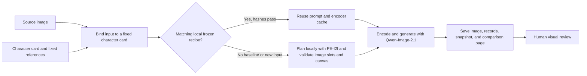

### Information Roles

- **The source image** controls the object being edited, layout, viewpoint, pose, expression, background, and lighting. For a person, the workflow aims to preserve pose and placement. For an object, it preserves silhouette, openings, handle, contents, and function. For an animal, it preserves species, face, fur, eyes, and pose.
- **A person’s character card** provides fixed identity and costume evidence. The automatic entry point selects the `human_complete` reference profile. Prompts limit references to appearance and avoid copying their poses, cameras, weapons, or backgrounds.
- **An object/animal design card** uses a `material_isolated` profile for palette, motifs, and accessory evidence. Prompts distinguish flat patterns from three-dimensional ornaments and translate the design into the target material without pasting a whole person or outfit onto an object.
- The local PE-I2I planner reads the images and instruction and produces a structured prompt. The program checks that the source-image slot is still referenced, that all referenced image slots are valid, and that the original canvas is not rewritten. Planning errors stop the run instead of silently falling back to a generic prompt.

Store character-card data by version and bind it to hashes of both original and derived assets. Put character visual references in `dataset/<character>/ckr/` and design/accessory references in `ckw/`. Model weights, input images, and personal character assets are not distributed with this repository. See [`dataset/README.md`](dataset/README.md) for the card fields and preparation notes. The public source does not include the visual-analysis and clothing-segmentation workers needed to build new cards. Although card-related utilities are present, they do not form a complete card-building pipeline here. Prepare a usable versioned card locally before using a new character; the workflow reports a clear error when a card is missing.

### Default Inference Recipe

| Stage | Local implementation |
|---|---|
| Prompt planning | Qwen-Image-2.1-PE-I2I (Qwen3.5-VL 9B); reads local weights and the system prompt provided with the model. The current script uses NF4 language weights and a BF16 vision-branch adaptation for memory use. |
| Condition encoding | Qwen3-VL 8B encoder included with Qwen-Image-2.1; BF16 encoding, automatically placed across GPU, CPU, and a per-run disk-offload directory by Accelerate. Condition images default to an area side length of 512. |
| Image generation | Qwen-Image-2.1 7B Transformer in NF4 plus BF16 VAE; 40 steps, CFG 1.0, block-wise Transformer CPU offload, and the unquantized image-prefix KV cache served layer by layer from CPU. |
| Output canvas | The current wrapper scales the source’s longest side to about 768 pixels and rounds dimensions to a multiple of 32. `reference_resolution=512` controls condition-image size, not the output edge. Qwen itself supports higher resolutions, but this tested recipe is not configured for 2K output. |
| Randomness | Default seed `42`; multiple seeds can be retained as separate candidates. The program does not select a seed or resample based on image quality. |
| Run protection | Each stage keeps logs, requests, and artifact summaries. A given `--out` directory can be owned by only one run at a time. Only the Windows native access violation `0xC0000005` receives one bounded recovery attempt, reusing the same inputs, prompt, cache, and seed. |

The recorded experimental environment is Python 3.12, PyTorch 2.14.1+cu130, Diffusers 0.42.1, Transformers 5.21.0, Accelerate 1.15.0, bitsandbytes 0.50.2, safetensors 0.8.0, Pillow 13.0.0, and NumPy 2.5.4. This records the environment that was run locally; it is not a one-command compatibility guarantee across GPUs. Select a PyTorch CUDA wheel and memory setup that fit the local GPU and driver.

## Models and Local Resources

**Qwen-Image-2.1 is required for every generated image.** PE-I2I is also required to automatically plan prompts for new inputs. It can be skipped only when a local frozen recipe matches the input, card, and code hashes exactly. Frozen recipes and character cards are not published, so a clean clone processing a new image should prepare both models.

| Stage | Required model and upstream | Complete local folder size on the research machine | Actual use in this workflow |
|---|---|---:|---|
| New image / fresh prompt planning (required for a clean clone) | [Qwen-Image-2.1-PE-I2I](https://huggingface.co/Qwen/Qwen-Image-2.1-PE-I2I) · [official prompt-rewriting notes](https://github.com/QwenLM/Qwen-Image-2.1#prompt-rewriting) | About 18.84 GB | Qwen’s image-edit prompt rewriter (Qwen3.5-VL 9B). The folder contains sharded weights, `config.json`, tokenizer/processor, `system_prompt.txt`, and a download manifest. It locally reads the source, character references, and edit constraints to plan a structured prompt. |
| Image conditioning and generation | [Qwen-Image-2.1](https://huggingface.co/Qwen/Qwen-Image-2.1) · [official code and model notes](https://github.com/QwenLM/Qwen-Image-2.1) | About 33.13 GB | The complete folder contains `text_encoder/`, `processor/`, `transformer/`, `vae/`, and `scheduler/`. Upstream architecture uses a 7B image Transformer, Qwen3-VL 8B encoder, and image VAE. The workflow loads these local weights; it does not use Turbo weights. |

These are measurements of the complete local model folders on the research machine, not just weight files and not GPU-memory requirements. Runtime uses BF16 encoders/vision branch and VAE, NF4 image Transformer/prompt model, and CPU/disk offload to lower peak VRAM. The complete model files still need to be stored locally. Offloading requires enough system memory and disk space and increases runtime.

The research machine currently uses these environment paths:

```powershell
$env:ENDLESS_PYTHON = 'D:\Python All\Pytorch Study\Endless_xxx\histories\model_lab\.venv\Scripts\python.exe'
$env:ENDLESS_QWEN_IMAGE_MODEL = 'E:\项目\Endless-XXX-models\Qwen-Image-2.1'
$env:ENDLESS_PE_I2I_MODEL = 'E:\项目\Endless-XXX-models\Qwen-Image-2.1-PE-I2I'
```

These paths apply only to the research machine; change all three variables to local paths on another computer. Model weights are not uploaded to GitHub. Download the complete files from the corresponding model cards and follow each model’s license. The Qwen-Image-2.1 model card specifies the Qwen Research License. For PE-I2I, use its own model card and any license file distributed with the weights. The project makes no unverified minimum-VRAM promise.

**Building character cards is a separate path that is not delivered with the current main branch.** The old local builder expected Qwen3-VL-4B-Instruct, Grounding DINO Tiny, and SAM2, and depended on `local_vision_tasks.py` and `local_clothing_masks.py`; those workers are not in the published branch, and Qwen3-VL-4B-Instruct and SAM2 are missing from the configured workspace locations. These are not required to generate an image when a valid card already exists. Do not download them just to run the generation workflow.

## Run

Model weights are not stored in Git. Set up and verify a Python environment compatible with the local GPU, then configure local paths in PowerShell:

```powershell
# Replace these with paths on this computer
$env:ENDLESS_PYTHON = 'C:\path\to\python.exe'
$env:ENDLESS_QWEN_IMAGE_MODEL = 'E:\models\Qwen-Image-2.1'
$env:ENDLESS_PE_I2I_MODEL = 'E:\models\Qwen-Image-2.1-PE-I2I'
```

Put the source image in `input/`, and the character references and versioned card in `dataset/<character>/`. From the repository root, run:

```powershell
python run_local_workflow.py --character ayaka --kind human --input input/source.png
```

Force fresh planning for a new input or retain several candidates in one run:

```powershell
python run_local_workflow.py --character ayaka --kind human --input input/source.png --fresh --seeds 42 101 202
```

For non-human tasks, set the kind explicitly, for example `--kind object` or `--kind animal`. Recovery behavior, parameters, and error boundaries are described in the [local workflow guide](LOCAL_WORKFLOW.md).

Generated images default to `output/result/<character>_result/`. The input snapshot, model-stage records, prompts, generation records, and an `index.html` comparison page are saved under `output/local_workflows/<run-id>/`. The report can be opened directly, but `quality_status` remains `not_evaluated` until a person reviews the images.

## Current Limits

1. Existing runs cover frozen-recipe reproduction for known characters/inputs and a small number of locally replanned images. They do not establish success rates for new characters, new inputs, or different GPUs.
2. Frozen baselines, versioned character cards, user images, and generated reports are local data and are not published with this branch. A clean clone without a baseline will replan with local PE-I2I for people; it cannot reproduce the exact frozen conditions or promise the same image quality as the original report.
3. The visual-analysis/clothing-region workers for card construction and automatic image-quality scoring/selection are not delivered on this branch. The optional `--feedback-rounds` and `--auto-compose` modes in standalone `local_edit_runtime.py` also depend on `local_edit_critic.py` and `local_grounded_regions.py`, which are not in the current public file set. The documented default workflow does not enable those options.
4. A successful generation means the files and records were written and the run completed; it does not prove that identity, pose, texture, or composition is acceptable. Final image review remains human.
5. This repository does not include model weights, character references, user inputs, generated output folders, the local model environment, or historical research directories. The new branch has no `LICENSE`; repository code usage terms still need to be set by the repository maintainer.

## Generated Results

Each column below uses the same source image: row one is the original, row two is the output for character 37, and row three is the output for Ayaka. These are 12 selected images from `output/result`. Some images were generated with different prompts or run strategies, so this gallery is for visual reference and is not a controlled A/B experiment.

<table>
  <thead>
    <tr><th>Set</th><th>cat</th><th>cup</th><th>human1</th><th>human2</th><th>jian1</th><th>jian2</th></tr>
  </thead>
  <tbody>
    <tr>
      <th>Original</th>
      <td>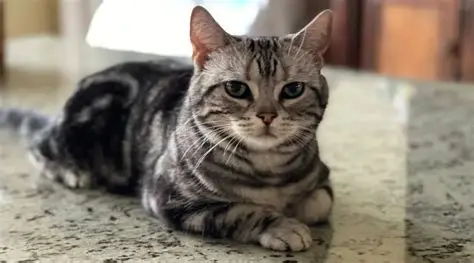</td>
      <td></td>
      <td>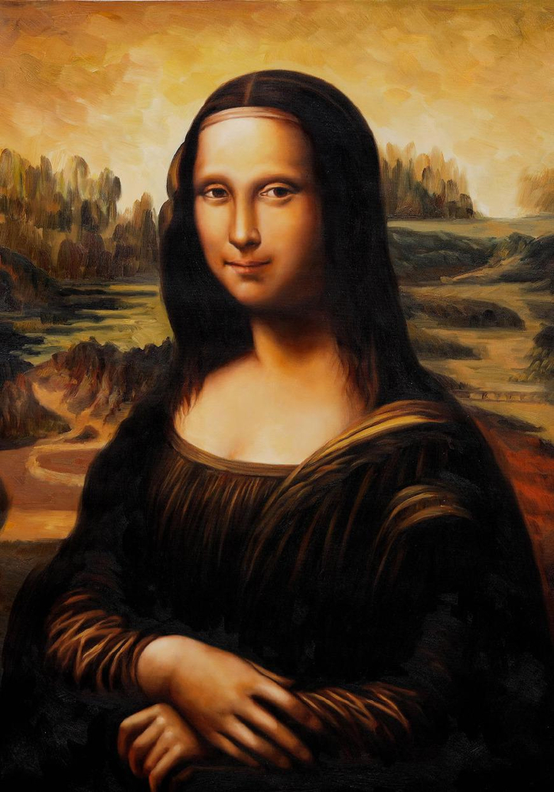</td>
      <td>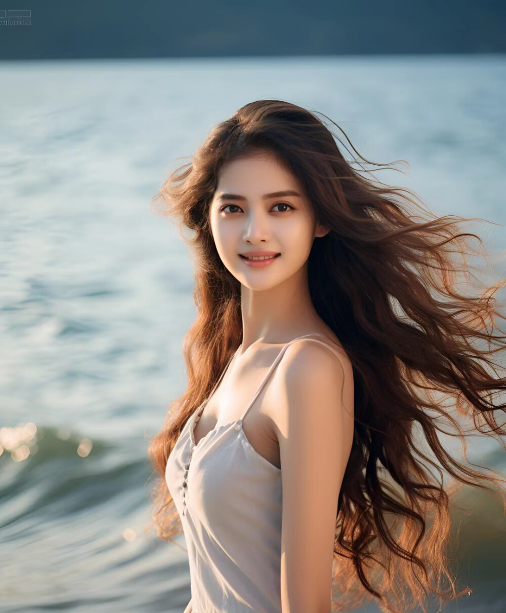</td>
      <td>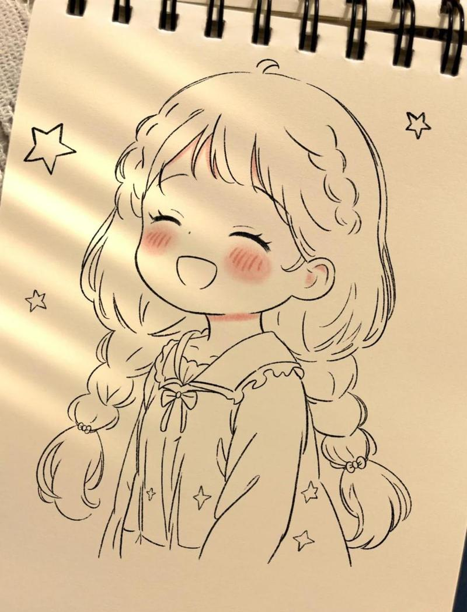</td>
      <td>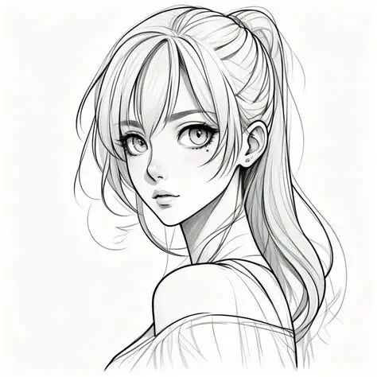</td>
    </tr>
    <tr>
      <th>37</th>
      <td>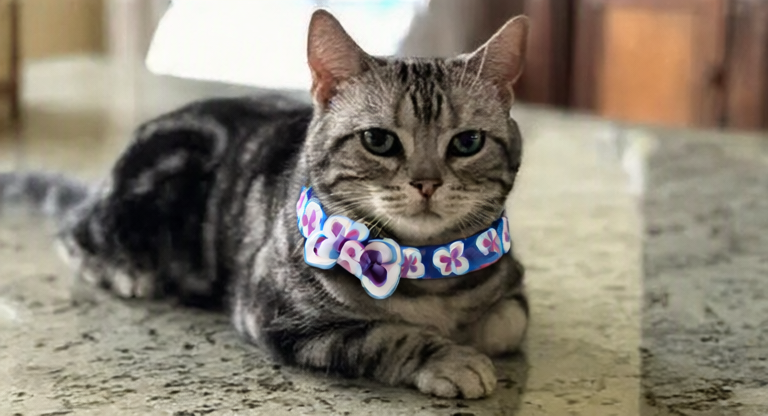</td>
      <td>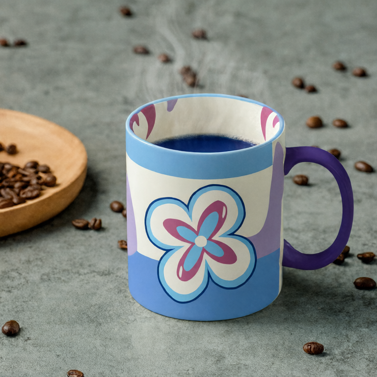</td>
      <td>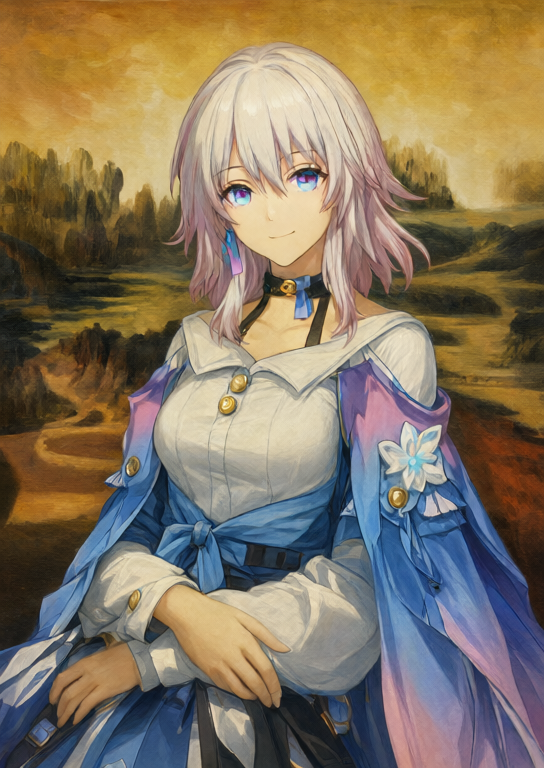</td>
      <td>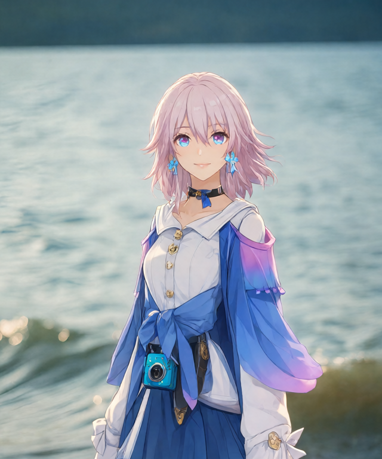</td>
      <td>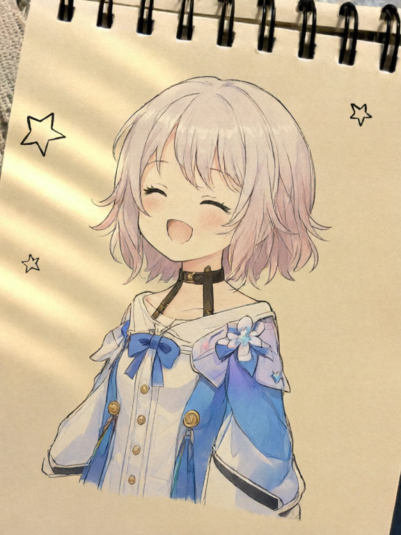</td>
      <td>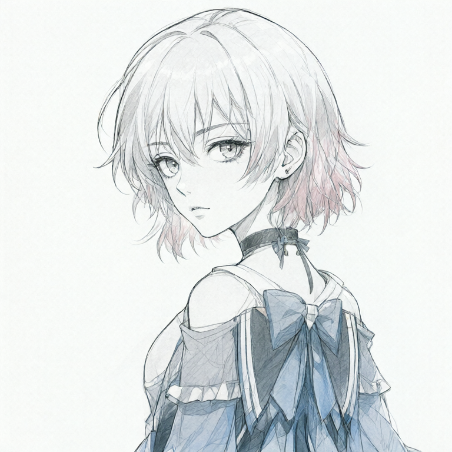</td>
    </tr>
    <tr>
      <th>Ayaka</th>
      <td>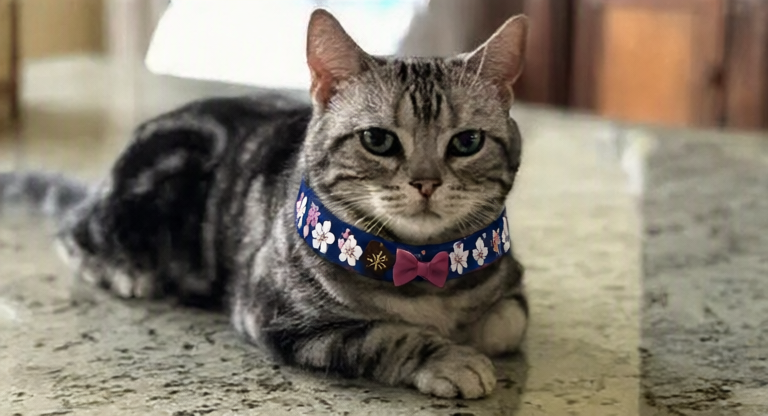</td>
      <td>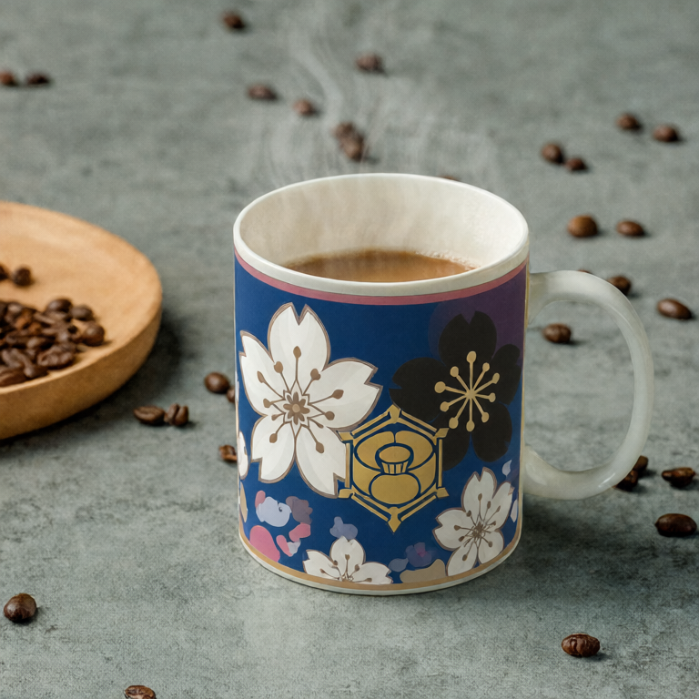</td>
      <td>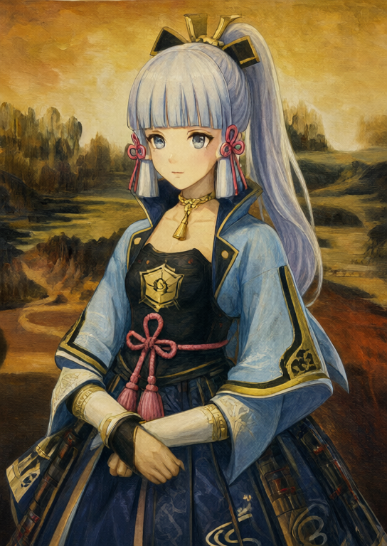</td>
      <td>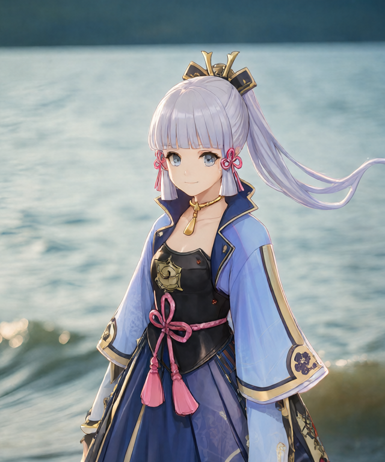</td>
      <td>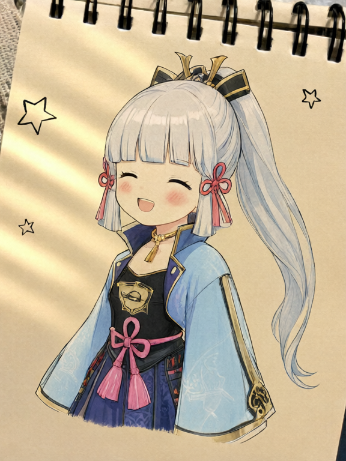</td>
      <td>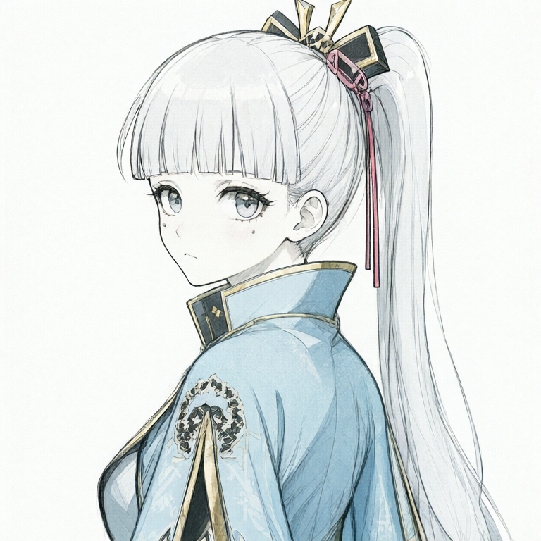</td>
    </tr>
  </tbody>
</table>

