# Endless-XXX：本地多参考图像转换

[简体中文](README.md) | [English](README.en.md)

本分支把项目主线切换为**完全本地运行的多参考图像编辑流程**：原图负责构图与场景，角色卡提供固定外观证据，本地提示规划器组织编辑约束，本地 Qwen-Image-2.1 完成生成。推理过程不调用 Codex、在线 GPT 或在线图像生成服务。

> 2026-11-23 起，`main` 指向当前本地 Qwen 工作流。原主线完整保留在 [`legacy/main-2026-11-23`](https://github.com/ZerothXX/Endless-XXX/tree/legacy/main-2026-11-23)。

## 两代技术路线

| 维度 | 原 `main`（现历史分支） | 当前 `main` |
|---|---|---|
| 核心方法 | 为角色训练 SDXL LoRA，再对输入图推理 | 原图与固定角色参考共同作为条件，直接用 Qwen-Image-2.1 多图编辑 |
| 角色信息 | 主要由角色 LoRA 权重承载 | 由版本化角色卡、固定参考图和本地生成提示显式提供；不为每个角色训练 LoRA |
| 新图提示 | 原推理提示与旧工作流配置 | 本地 Qwen-Image-2.1-PE-I2I 根据原图、参考图和编辑约束重写提示 |
| 人物/非人物 | 旧版训练及推理代码和 Web 界面 | 人物、物品、动物使用不同的编辑约束；保留主体结构并把角色外观映射到目标材质 |
| 稳定性控制 | 依赖训练权重与原推理链路 | 精确匹配时可复用本地冻结配方；否则重新规划；对输入、角色卡、代码和生成物做哈希校验，并记录提示、模型路径与参数 |
| 质量验收 | 由旧工作流决定 | 运行只保证技术交付；不自动打分、筛图或判定合格，最终仍需人工看图 |

原主线详见[历史分支 README](https://github.com/ZerothXX/Endless-XXX/blob/legacy/main-2026-11-23/README.md)。新旧路线的完整实现各自在对应分支中保留；两者不会共享同一个默认运行入口。

## 当前流程

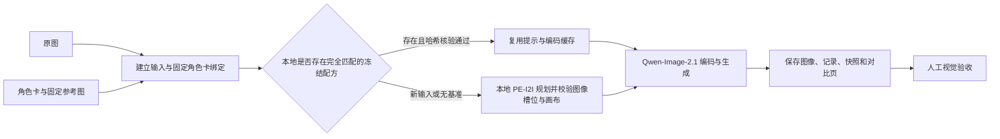

### 信息分工

- **原图**决定待编辑对象、画面布局、视角、姿势、表情、背景和光照。人物编辑尽量保留原姿势与主体位置；物品编辑保留轮廓、开口、把手、内容物和功能；动物编辑保留物种、脸、毛发、眼睛与姿态。
- **人物角色卡**固定提供角色身份与服装证据。当前自动入口选择 `human_complete` 参考配置；提示把参考图限定为外观来源，不复制其姿势、相机、武器或背景。
- **物品/动物设计卡**用 `material_isolated` 配置提供配色、纹样和饰品证据。提示区分平面花纹和立体配件，并按目标材料重新表达设计；不会把完整服装或人物贴到物体上。
- 本地 PE-I2I 读取图像与指令后生成结构化提示。程序检查原图槽位仍被引用、引用的图像槽位合法、原图画布尺寸不被改写；规划失败会报错，不静默改用通用提示。

角色卡数据应按版本保存，并绑定原始素材和派生素材摘要。`dataset/<角色>/ckr/` 放角色视觉参考，`ckw/` 放设计/饰品参考；模型、输入图和个人角色素材不随本仓库发布。卡片字段与准备说明见 [`dataset/README.md`](dataset/README.md)。当前公开源码没有包含角色卡构建所需的视觉分析与服装分割 worker，因此新角色需要先在本地准备可用的版本化角色卡；仓库会在缺卡时给出明确错误，不会声称已自动构建。

### 当前默认推理配方

| 阶段 | 本地实现 |
|---|---|
| 提示规划 | Qwen-Image-2.1-PE-I2I（Qwen3.5-VL 9B）；离线读取本地权重和随模型提供的系统提示；当前脚本用 NF4 语言权重、BF16 视觉分支适配显存 |
| 条件编码 | Qwen-Image-2.1 内置 Qwen3-VL 8B；BF16 编码，通过 Accelerate 自动分配到 GPU、CPU 与本次运行的磁盘卸载目录；条件图默认按面积边长 512 预处理 |
| 图像生成 | Qwen-Image-2.1 7B Transformer NF4 + BF16 VAE；40 步，CFG 1.0；Transformer 逐块 CPU 卸载；未量化图像前缀 KV 缓存在 CPU 按层调用 |
| 输出画布 | 当前封装把原图长边缩放到约 768 像素，并向 32 的倍数取整；`reference_resolution=512` 是条件图尺寸参数，不是输出边长。Qwen 模型本身支持更高分辨率，但这条已运行配方没有按 2K 输出配置 |
| 随机性 | 默认种子 `42`；可一次保留多个种子的全部候选。程序不根据画质自动挑选种子或重采样 |
| 运行保护 | 每个阶段保留日志、请求与产物摘要；同一 `--out` 目录只能被一个运行占用；只针对 Windows 原生访问冲突 `0xC0000005` 有界恢复一次，且复用相同输入、提示、缓存和种子 |

当前实验环境版本记录为 Python 3.12、PyTorch 2.14.1+cu130、Diffusers 0.42.1、Transformers 5.21.0、Accelerate 1.15.0、bitsandbytes 0.50.2、safetensors 0.8.0、Pillow 13.0.0 和 NumPy 2.5.4。这是本机已运行环境记录，不是跨 GPU 的一键安装保证；PyTorch CUDA wheel、Diffusers 的 Qwen-Image-2.1 支持及显存/内存配置都需要与本机硬件匹配。

## 模型与本地资源

**每次生成都需要 Qwen-Image-2.1。** 若要对新输入执行完整自动规划，还需准备 PE-I2I。只有在本地已经有与输入、角色卡和代码哈希完全匹配的冻结配方时，才可跳过 PE-I2I；冻结配方和角色卡不随仓库发布，所以干净克隆要处理新图时应同时准备两套模型。

| 阶段 | 必需模型与上游 | 当前机器的完整本地目录大小 | 流程实际用途 |
|---|---|---:|---|
| 新图/重新规划（干净克隆必需） | [Qwen-Image-2.1-PE-I2I](https://huggingface.co/Qwen/Qwen-Image-2.1-PE-I2I) · [官方提示规划说明](https://github.com/QwenLM/Qwen-Image-2.1#prompt-rewriting) | 约 18.84 GB | Qwen 官方图像编辑提示重写模型（Qwen3.5-VL 9B）；目录包括分片权重、`config.json`、tokenizer/processor、`system_prompt.txt` 与下载清单。它在本机读取原图、角色参考和编辑约束，规划结构化提示。 |
| 图像条件编码与生成 | [Qwen-Image-2.1](https://huggingface.co/Qwen/Qwen-Image-2.1) · [官方代码与模型说明](https://github.com/QwenLM/Qwen-Image-2.1) | 约 33.13 GB | 完整目录包含 `text_encoder/`、`processor/`、`transformer/`、`vae/`、`scheduler/`。上游架构为 7B 图像 Transformer、Qwen3-VL 8B 编码器和图像 VAE；当前流程从该本地权重加载，不使用 Turbo 权重。 |

上述大小是当前研究机完整模型目录的实测磁盘占用，不是单独权重大小或显存需求。流程运行时使用 BF16 编码器/视觉分支与 VAE、NF4 图像 Transformer/提示模型，并通过 CPU、磁盘卸载降低显存峰值；完整权重仍需存放在本地。此卸载方案需要足够的系统内存、磁盘空间，并会增加运行时间。

当前研究机的环境变量指向：

```powershell
$env:ENDLESS_PYTHON = 'D:\Python All\Pytorch Study\Endless_xxx\histories\model_lab\.venv\Scripts\python.exe'
$env:ENDLESS_QWEN_IMAGE_MODEL = 'E:\项目\Endless-XXX-models\Qwen-Image-2.1'
$env:ENDLESS_PE_I2I_MODEL = 'E:\项目\Endless-XXX-models\Qwen-Image-2.1-PE-I2I'
```

以上路径只适用于当前研究机；其他电脑须把三个变量改成本机 Python 和模型目录。模型权重没有上传到 GitHub，首次使用前须从对应模型卡下载完整文件并遵守各自许可。Qwen-Image-2.1 上游模型卡标注为 Qwen Research License；PE-I2I 的许可应以它自己的模型卡和权重目录内许可文件为准。当前环境记录的依赖版本为 Python 3.12、PyTorch 2.14.1+cu130、Diffusers 0.42.1、Transformers 5.21.0、Accelerate 1.15.0、bitsandbytes 0.50.2、safetensors 0.8.0、Pillow 13.0.0、NumPy 2.5.4。CUDA 版 PyTorch 需按本机显卡和驱动选择；仓库不承诺这组版本可以不经调整直接适配所有 GPU。没有完成跨硬件实测的最低显存数值不作承诺。

**角色卡重建是另一条尚未随当前主线交付的链路。** 旧的本地构建脚本指向 Qwen3-VL-4B-Instruct、Grounding DINO Tiny 和 SAM2，并依赖 `local_vision_tasks.py` 与 `local_clothing_masks.py`；这些 worker 未包含在本分支，且 Qwen3-VL-4B-Instruct 与 SAM2 在当前工作区配置位置缺失。因此它们不是当前图像生成必需模型；运行前需要提供已经构建且哈希有效的角色卡。不要为了运行生成主链路额外下载这些模型。

## 运行

模型权重不放入 Git。安装并验证适配本机 GPU 的 Python 环境后，在 PowerShell 设置本地路径：

```powershell
# 改成当前电脑上实际安装的位置
$env:ENDLESS_PYTHON = 'C:\path\to\python.exe'
$env:ENDLESS_QWEN_IMAGE_MODEL = 'E:\models\Qwen-Image-2.1'
$env:ENDLESS_PE_I2I_MODEL = 'E:\models\Qwen-Image-2.1-PE-I2I'
```

把待处理图片放进 `input/`，把角色素材和版本化角色卡放进 `dataset/<角色>/`，然后从仓库根目录运行：

```powershell
python run_local_workflow.py --character ayaka --kind human --input input/source.png
```

对新输入强制重新规划，或一次保留多个候选：

```powershell
python run_local_workflow.py --character ayaka --kind human --input input/source.png --fresh --seeds 42 101 202
```

非人物任务显式指定类型，例如 `--kind object` 或 `--kind animal`。完整恢复语义、参数和错误边界见[本地流程说明](LOCAL_WORKFLOW.md)。

默认生成图保存到 `output/result/<角色>_result/`；每次运行的输入快照、模型阶段记录、提示、生成记录和 `index.html` 对比页保存在 `output/local_workflows/<运行编号>/`。报告可以直接打开，但 `quality_status` 会保持 `not_evaluated`，直到人工完成视觉验收。

## 当前可确认的边界

1. 已有测试覆盖已知角色/输入的冻结配方重现与少量本地重新规划成图；它不足以估计新角色、新输入或跨 GPU 的成功率。
2. 冻结基准、版本角色卡、用户图片和成图报告都属于本地数据，不随新主线公开。干净克隆没有冻结基准时，人物任务会走本地 PE-I2I 重新规划，不会复现原报告中的冻结条件或承诺同等画质。
3. 角色卡视觉/服装区域构建 worker、自动画质打分/筛选，目前没有作为本分支已交付功能。独立 `local_edit_runtime.py` 中可选的 `--feedback-rounds` 与 `--auto-compose` 还依赖 `local_edit_critic.py` 和 `local_grounded_regions.py`；这两个脚本不在当前公开文件集内，README 所述默认流程不启用这些选项。
4. 自动生成成功只表示文件与记录完整、运行链路完成；不代表角色还原、姿势保持、纹理或构图已经合格。逐图视觉验收仍由人完成。
5. 本仓库不含模型权重、角色参考图、`input/`、`output/`、本地模型环境和历史研究目录。新分支未新增 `LICENSE`；代码使用权限需由仓库维护者另行明确。

## 生成效果展示

下表按列对应同一张输入图：第一行是原图，第二行是角色“37”的输出，第三行是绫华的输出。展示的是 `output/result` 中选定的 12 张结果。不同图片可能来自不同提示和运行策略，因此这组图片用于直观看成图，不是严格控制变量的 A/B 实验。

<table>
  <thead>
    <tr><th>类别</th><th>cat</th><th>cup</th><th>human1</th><th>human2</th><th>jian1</th><th>jian2</th></tr>
  </thead>
  <tbody>
    <tr>
      <th>原图</th>
      <td></td>
      <td></td>
      <td>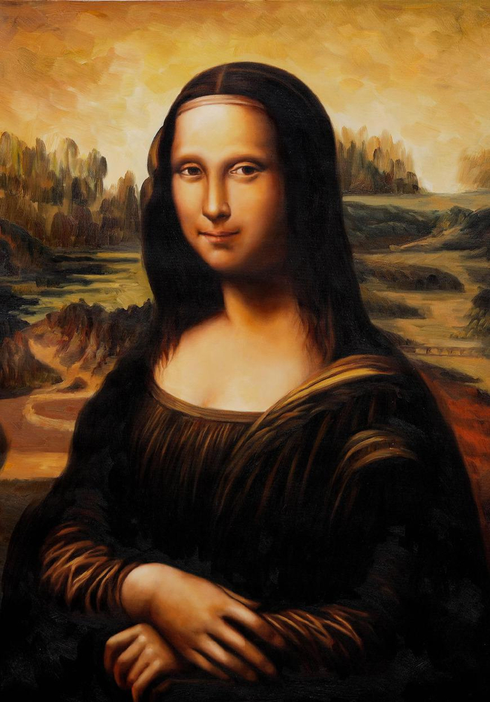</td>
      <td></td>
      <td>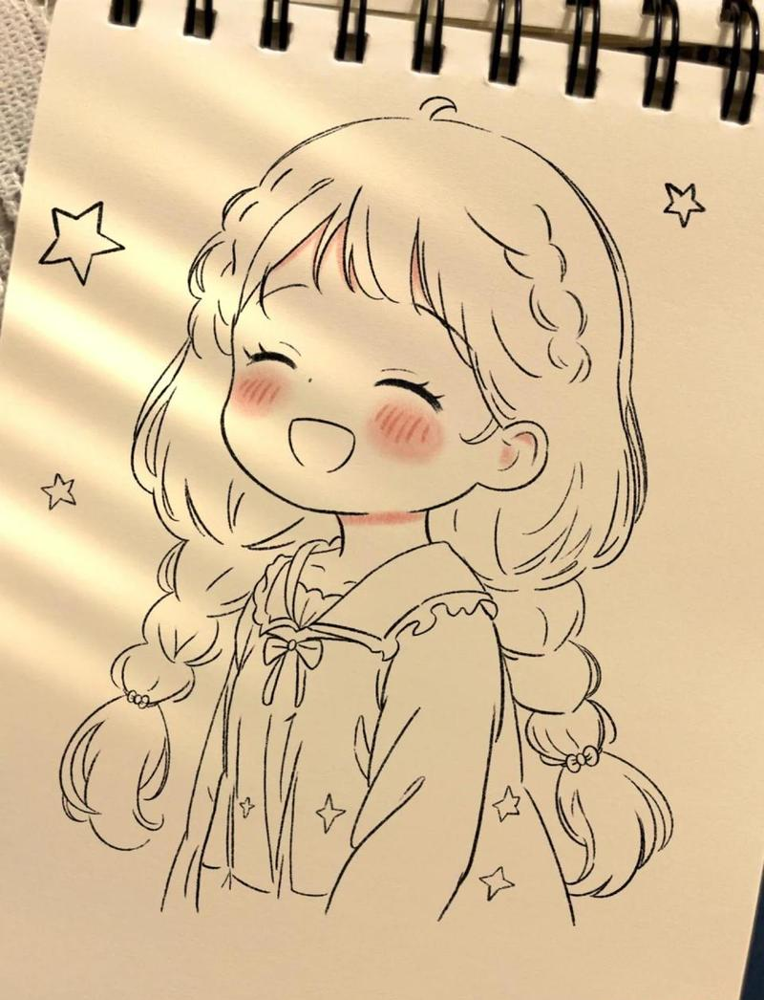</td>
      <td></td>
    </tr>
    <tr>
      <th>37</th>
      <td>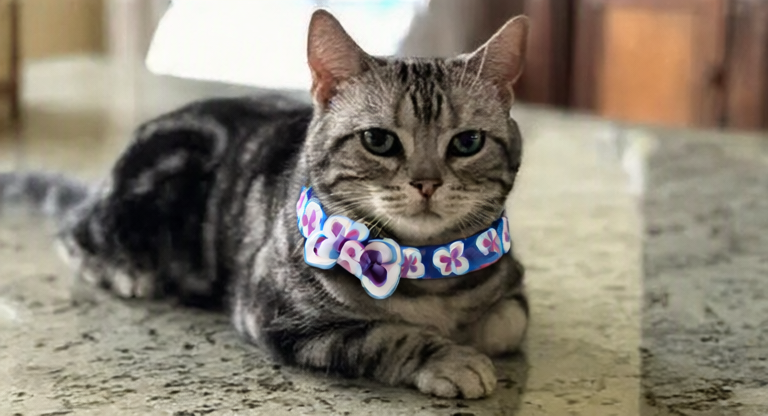</td>
      <td>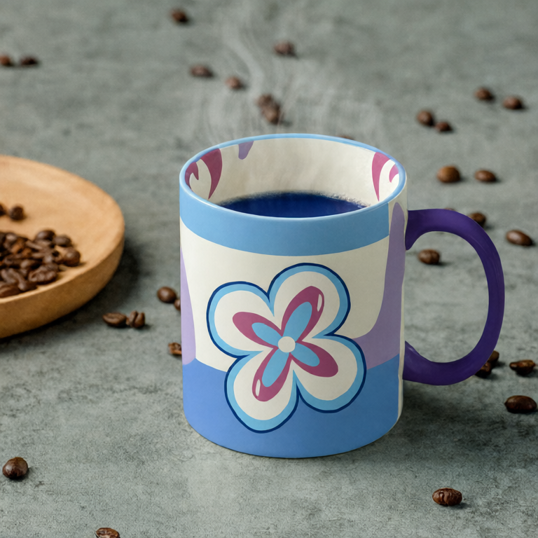</td>
      <td>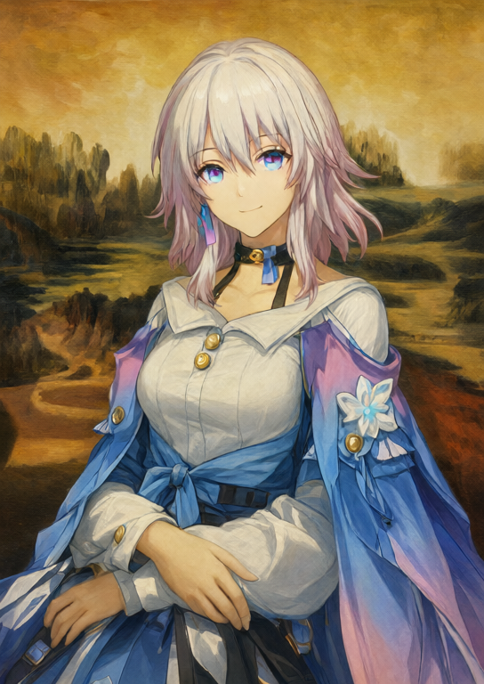</td>
      <td></td>
      <td>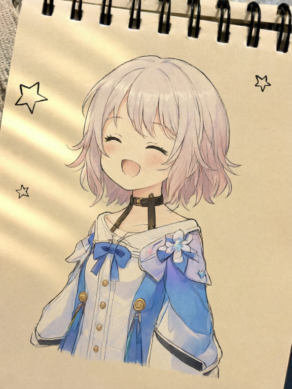</td>
      <td>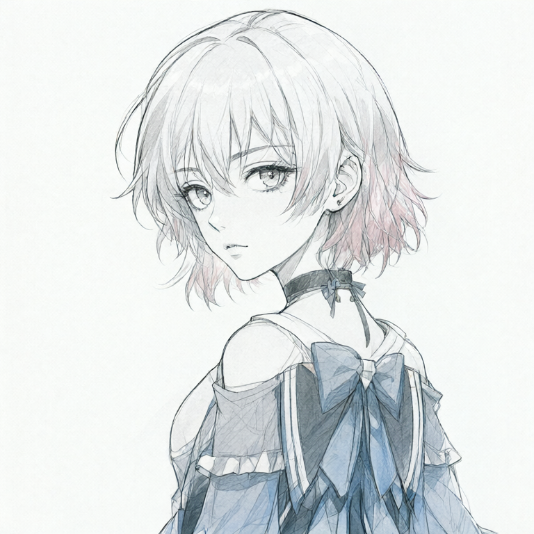</td>
    </tr>
    <tr>
      <th>绫华</th>
      <td>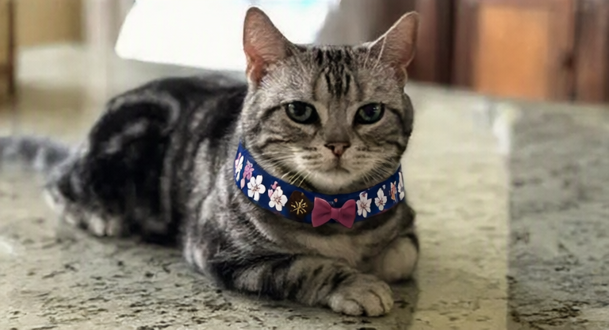</td>
      <td>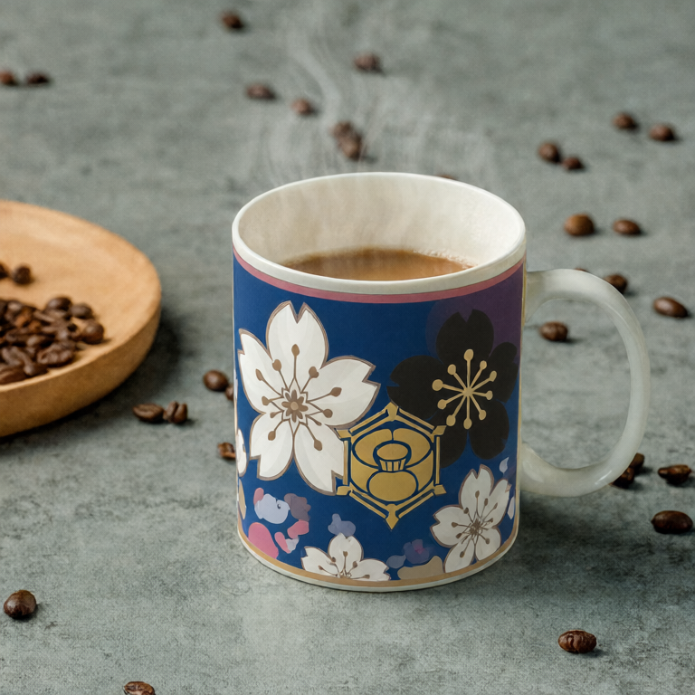</td>
      <td>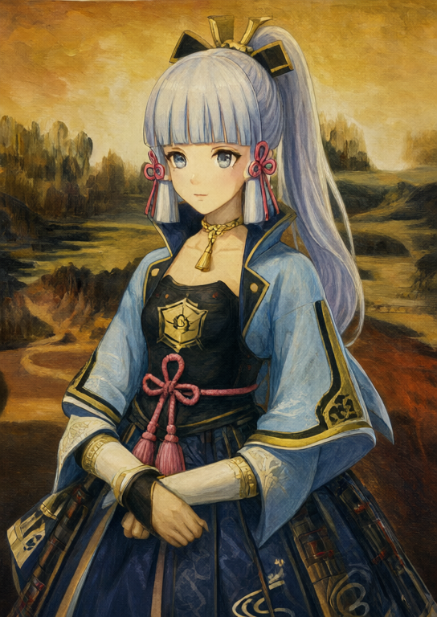</td>
      <td></td>
      <td>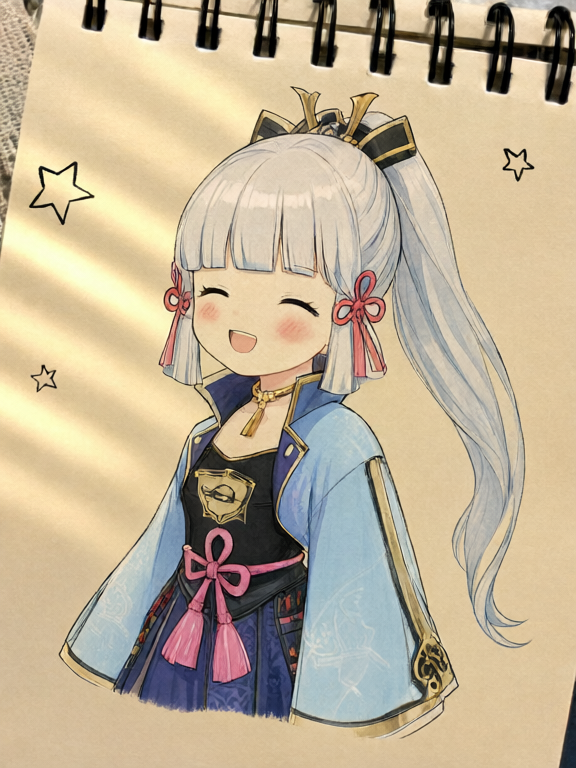</td>
      <td>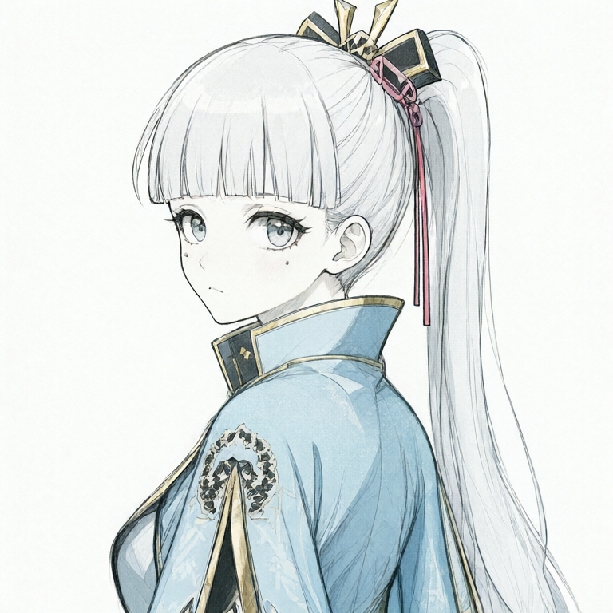</td>
    </tr>
  </tbody>
</table>


