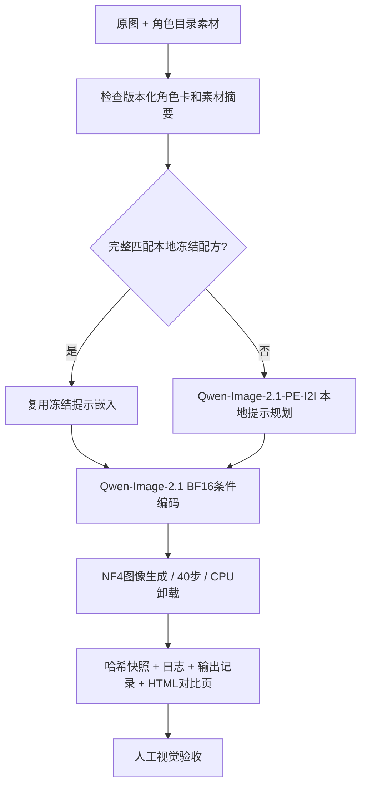

# 当前主线结构

## 主链路

## 模块

- `run_local_workflow.py`：批量入口及仅对已识别原生访问冲突执行的有限恢复监督器。
- `local_workflow.py`：角色卡检查、输入与模型绑定、冻结配方选择、提示规划、分阶段编码/生成、结果汇总。
- `local_prompt_planner.py`、`safetensors_pread.py`：本地 PE-I2I 提示规划器及按张量范围读取权重的 Windows 辅助实现。
- `local_multiref.py`：Qwen-Image-2.1 条件编码与生成；统一 source/reference 图像槽位，缓存编码条件，保存输出记录。
- `local_edit_runtime.py`：固定角色/材质参考的通用计划构造器，包含人物、物品、动物各自的保留约束。
- `local_integrity.py`：摘要、快照及已有冻结基准核验；旧研究脚本不进入新主线。
- `character_card.py`、`local_color_statistics.py`、`local_shape_signature.py`、`local_palette_prompt.py`：版本角色卡结构与本地派生特征工具。角色卡视觉/服装分割 worker 目前不在本公开发布集中。
- `gpu_slot.py`、`local_quant_offload.py`：本机 GPU 互斥与量化权重逐块卸载辅助。

## 信任与验收边界

输入绑定、输出完整、阶段退出码与画质是不同信号。输入或 worker 哈希不匹配时拒绝复用；技术阶段成功不等于视觉合格。当前公开主线不做自动审美打分或候选淘汰，人工视觉验收仍是质量标准。

